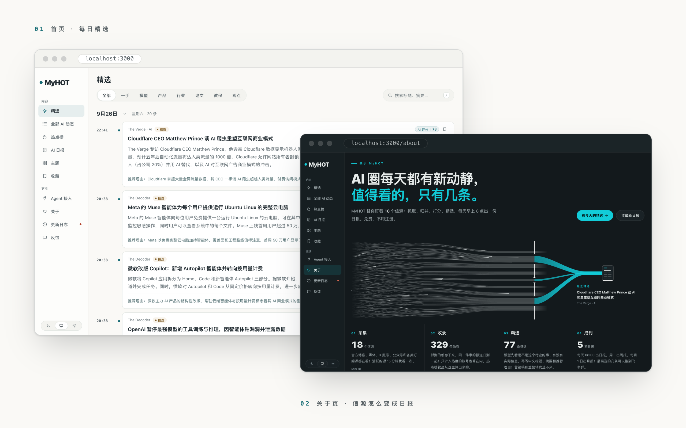

<p align="center">
  <picture>
    <source media="(prefers-color-scheme: dark)" srcset="docs/assets/banner-dark.png">
    
  </picture>
</p>

<p align="center">
  <a href="LICENSE"></a>
  
  
  
  <a href="https://aihot.news"></a>
</p>

<p align="center">
  <b>ニュースを見つけ、デイリーブリーフィングまで自分で書くウェブサイトフレームワークです。</b><br>
  情報源と「何が重要か」の知見を自分のものに差し替えれば、あなたの分野のニュースサイトになります。
</p>

<p align="center">
  <a href="README.md">简体中文</a> · <a href="README.en.md">English</a> · <b>日本語</b>
</p>

<p align="center">
  <a href="#動かしてみる">動かしてみる</a> ·
  <a href="#あなたの分野のサイトにする">あなたの分野のサイトにする</a> ·
  <a href="#仕組み">仕組み</a> ·
  <a href="#ドキュメント">ドキュメント</a> ·
  <a href="https://github.com/KKKKhazix/AIHOT/discussions">Discussions</a>
</p>

<br>

## これは何か

[AIHOT](https://aihot.news) は、私が作った AI ニュースサイトです。毎日、一連の情報源から素材を集めます。言語モデルがすべての項目をふるいにかけ、見込みのあるものを独立に 2 回採点して本当に読む価値のあるものを選び、それぞれに見出しと要約を書きます。異なる情報源による同じ出来事の報道は 1 つのイベントにまとめられ、イベントは話題にしている情報源の数で順位付けされます。毎朝、デイリーブリーフィングを公開します。

このリポジトリは、そのエンジンとフレームワークです。ウェブサイト、管理画面、精選パイプライン、クラスタリングと注目度のアルゴリズム、そして**すべてのプロンプトとすべての精選しきい値の全文**が含まれています。

## なぜオープンソースにしたのか

この半年ほど、法律、人事、金融、貴金属の分野で働く多くの友人から、自分の分野向けにも作れないかと聞かれてきました。

私にはできません。あなたの分野のことを知らないからです。どの情報源が役に立つのか、あなたにとってどんなニュースがニュースなのか、私にはわかりません。

でも、あなたにはわかります。

全員のために作ることはできないので、その火種を皆さんに手渡すことにしました。

## 始める前に

- **インターフェースとサイトが書く文章はすべて中国語です。** 出力言語は [`industry/prompts/`](industry/prompts/) のプロンプトで決まり、インターフェースのテキストは [`site/site.ts`](site/site.ts) とコードの中にあります。別の言語で運用するには、エージェントにそれらを翻訳してもらってください（[あなたの分野のサイトにする](#あなたの分野のサイトにする)を参照）。このリポジトリのほかのドキュメントも中国語ですが、コーディングエージェントなら問題なく読めます。
- **私はプロの開発者ではありません。** もともとはデザイナーで、半年前はコードもろくに読めませんでした。このコードベースは AI と一緒に書き直したものです。以前よりずっとすっきりしましたが、うまく書けていない部分もきっとあります。Issue は歓迎します。すぐには返信できないかもしれません。あらかじめお詫びします。
- **これは AIHOT のエンジンです。** 本番環境で AIHOT を動かしているのと同じエンジンのコードをそのまま書き出したもので、丁寧に磨き上げた汎用フレームワークではありません。AIHOT の更新はできるだけ取り込むつもりですが、すべてを約束することはできません。モデルのリーダーボード、Codex のリセット監視、トピックページのマイルストーンのタイムラインなど、AI 分野でしか意味のない機能は、インストール可能な Agent Skill ファイルや AIHOT 独自の運用ツールとともに AIHOT に残しています。こちらでは、エージェントは MCP とサイトの `/agent` ページから利用します。
- **AIHOT の情報源リストと運用データは含まれていません。** リポジトリにはデモとして 18 の公開 AI ニュース情報源が入っており、動かして何をするのかを確かめるには十分です。実際の情報源は、あなたの分野のものにしてください。
- **AIHOT の名前やロゴは使わないでください。** あなた自身の名前を付ければ、それはあなたのサイトです。

## 仕組み

<picture>
  <source media="(prefers-color-scheme: dark)" srcset="docs/assets/how-dark.png">
  
</picture>

項目は情報源から入ってきて、重複のチェックと事前スクリーニングを受けます。重要かもしれない項目は独立に 2 回採点され、見出しと要約が付けられ、ほかの報道とともに 1 つのイベントにまとめられ、その注目度に加算されます。本文がない、またはリンクだけの X の投稿は、執筆や翻訳のモデル呼び出しを行わずに、元のリンクとメディアをそのまま残します。項目が精選に入るのは、スコアがしきい値を超え、すでに選ばれたニュースと重複しない場合だけです。デイリーブリーフィングはその日の主要なニュースからルールに従って編集され、週報と月報はデイリーから編集されます。各ステップのプロンプトは [`industry/prompts/`](industry/prompts/) にあるので、基準を変えるのにコードを変える必要はありません。[精選とキャリブレーション](docs/selection.md)をご覧ください。

### クラスタリングと注目度

<picture>
  <source media="(prefers-color-scheme: dark)" srcset="docs/assets/cluster-dark.png">
  
</picture>

同じ出来事は一度しか起きません。公式サイトが発表し、10 のメディアが繰り返し、X では一日中議論が続きます。読者はそれを一度見れば十分です。AIHOT はこれらを 1 つの**イベント**にまとめます。見出しと要約の埋め込み（埋め込みサービスがない場合はテキストの重なり）で過去 2 週間から候補を探し、同じ出来事なのか、続報なのか、別々の出来事なのかをモデルに尋ねます。迷ったときはまとめる方を選び、執筆の前にモデルがそのまとめを改めて確認します（確認には別のプロバイダーを使えます。`GROUP_REVIEW_MODEL` を設定してください）。

**注目度**は記事単位ではなくイベント単位で計算されます。48 時間以内で、独立した情報源はそれぞれ 1 回だけ数えられ、24 時間ごとに半減します。繰り返し取得しても加算されず、1 つのメディアが 10 本の記事を出しても 1 回としか数えないので、上位に来るのは本当に多くの人が話題にしているものです。

### 速度

<picture>
  <source media="(prefers-color-scheme: dark)" srcset="docs/assets/perf-dark.png">
  
</picture>

## 得られるもの

| | |
|---|---|
| **6 種類の情報源** | RSS、ウェブの一覧ページ、JSON API、X アカウント、WeChat 公式アカウント、そして自作のスクリプトから送り込むコンテンツに対応しています。情報源は 3 つの階層（公式の一次情報、公式および準公式のアカウント、メディアと個人）に分かれ、それぞれに精選のしきい値があります。取得頻度は、情報源の更新頻度に合わせて調整されます |
| **精選** | 事前スクリーニングのあと、同じ評価基準で独立に 2 回採点し、情報源の階層で決まるしきい値で判定します。1 つのニュースが使う枠は 1 つで、同じニュースを言い換えたものは入りません。すべてのプロンプトとしきい値は公開されていて編集でき、自分でラベル付けしたサンプルを使って SelectBench でキャリブレーションできます |
| **執筆** | 見出し、結論から書く要約、読む理由、外国語の本文の全文翻訳を作成します。カテゴリー、タグ、ニュースの事実は別に抽出し、原文が触れていない企業をモデルが見出しに入れないようにする対策もあります |
| **クラスタリング** | 異なる情報源による同じ出来事の報道は 1 つのイベントになり、続報は同じイベントにまとめられ、イベントページには概要が表示されます。続報と報道のタイムラインは、新しい順と古い順をまとめて切り替えられます。クラスタリングの手動修正が上書きされることはありません |
| **トレンド** | イベントごとの注目度で、独立した情報源が多いほど高くなり、X での議論も加算されます。6 時間前と比べて、急上昇しているものには上昇中、新たに登場したものには新着の印が付きます |
| **日報、週報、月報** | デイリーブリーフィングは毎日（デフォルトは 08:00）、その日の主要なニュースからルールに従って編集されます。1 つの出来事につき 1 項目で、すでに取り上げた出来事は新しい動きがあったときだけ再登場し、モデルは呼び出しません。週報は毎週月曜日、月報は毎月 1 日（デフォルトは 10:00 と 10:30）にデイリーから編集され、モデルが書くのは概要とセクションの導入文だけです。時刻は `site/site.ts` の `EDITION_TIMES` で変更できます |
| **トピックと検索** | 企業、分野、コンテンツ形式の 3 種類のトピックページがあります。見出しと要約の検索と、全文の関連度検索ができます |
| **閲覧の設定** | ライトとダークの外観、サイトのデフォルトフォントとブラウザーのデフォルトフォントを選べます。保存した項目と閲覧の設定はデバイスに残り、バックアップとしてエクスポートとインポートができます |
| **エージェント向け** | RSS（精選、すべて、全文、日報、週報、月報）、公開 API、MCP、Agent Markdown、`llms.txt` を提供します。人にもエージェントにも同じコンテンツを届けます |
| **管理画面** | 情報源の管理と試し取得、コンテンツの診断とスコアの手動修正、精選の評価、ステップごとに別のモデルを設定、有料サービスの予算ブレーカー、実行履歴とアラートを備えています |

## ちょっと見てみる

<picture>
  <source media="(prefers-color-scheme: dark)" srcset="docs/assets/shots-dark.png">
  
</picture>

<p align="center"><sub>デモの情報源で動かしたローカルサイトのスクリーンショットです。サイト名はデフォルトの MyHOT です。</sub></p>

## 動かしてみる

独立した自分のサイトを作るには、[Use this template](https://github.com/KKKKhazix/AIHOT/generate) をクリックし、作成されたリポジトリをクローンしてください。上流の更新を取り込み続けたい場合やコントリビュートしたい場合は、代わりに fork してください。以下のコマンドは、直接試してみるためのものです。

必要なものは、[Docker](https://docs.docker.com/get-started/get-docker/)、[Node.js 24](https://nodejs.org/en/download)（設定を生成する `init-env` の実行に使います）、そして OpenAI 互換のモデル API（DeepSeek、Qwen、Zhipu GLM など）の API キーです。

`init-env` はデフォルトで DeepSeek を設定します。ほかのプロバイダーを使う場合は、`.env.example` の例に従って `.env` の `LLM_BASE_URL`、`LLM_MODEL`、`LLM_EXTRA_JSON` を変更してください。推論モデル（答える前に考えるモデル）を使う場合は、推論のための出力の余地を残すよう `LLM_REASONING_TOKENS` も設定してください。

```bash
git clone https://github.com/KKKKhazix/AIHOT.git myhot
cd myhot
node scripts/init-env.ts --llm-key <your model API key>
docker compose up -d --build
```

<http://localhost:3000> を開いてください。管理画面は `/admin` にあり、管理者パスワードは `.env` の `ADMIN_PASSWORD` です。1〜2 分でコンテンツが表示され始め、最初の取り込みの処理には 30 分ほどかかります。

Node のないマシン、中国本土のサーバー、ドメインと HTTPS、Docker を使わずに Linux や macOS（Windows では WSL2）で直接動かす方法については、[デプロイ](docs/deploy.md)をご覧ください。

サイトが立ち上がったら、`/agent` で MCP、RSS、API での接続方法をコピーできます。ウェブページしか読めないエージェントは `/api/v1/agent` から始めます。API の説明は `/openapi-v1.json` にあります。

## あなたの分野のサイトにする

いちばん簡単な方法は、コーディングエージェント（Claude Code でも Codex でもかまいません）を開き、このリポジトリを渡して次のように伝えることです。

```text
Please read AGENTS.md and docs/customize.md, and turn this site into a news site for the "XX" field.
What I care about: … (the sources you want to watch, what news you think matters and what doesn't; the more specific the better).
If the site should be in English (or another language), also translate the interface text and rewrite the prompts in industry/prompts/ to write in that language.
When you're done, run npm run typecheck, npm test and node scripts/smoke.ts, and tell me which decisions are still mine to make.
```

変更するもののほとんどは [`site/`](site/) と [`industry/`](industry/) のフォルダーにあり、コード自体はほぼそのままで済みます。

| ファイル | 変更する内容 |
|---|---|
| `site/site.ts` | サイト名、分野の用語、公開時刻、ホームページの文言、about ページ、項目とレポートの言い回し、公開インターフェースのカテゴリー |
| `industry/taxonomy.ts`, `industry/topics.json` | カテゴリー、タグ、トピック |
| `industry/sources.json` | 初回起動時に取り込まれる情報源 |
| `industry/prompts/` | 精選の基準と執筆の要件。**あなたの分野の知見はここに入れます** |
| `industry/selection.ts` | 精選のしきい値 |
| `site/models.ts` | 各ステップがデフォルトで使うモデル（任意。設定しなければ、すべてのステップで `.env` のモデルを使います） |
| `site/brand/`, `site/pages/`, `site/public/`, `site/changelog.json` | アイコンとロゴ、利用規約とプライバシーに関する通知、`robots.txt` などサイトのルートから配信されるファイル、変更履歴 |
| `modules/` | フレームワークになく、あなたのサイトだけが必要とする機能をモジュールとして置きます。[アーキテクチャ](docs/architecture.md#模块)の「模块」を参照してください |

いちばん時間をかける価値があるのは、採点の評価基準（`industry/prompts/selection-score.md`）としきい値です。自分でラベル付けした 100〜200 件の項目を用意して `scripts/eval-selection.ts` にかけ、どれだけ正確に選べるかを確認し、戻って調整してください。やり方は[精選とキャリブレーション](docs/selection.md)にあります。

## ドキュメント

以下のドキュメントは中国語です。

| ドキュメント | 内容 |
|---|---|
| [あなたの分野のサイトにする](docs/customize.md) | サイト名、カテゴリー、トピック、情報源、プロンプト、しきい値、モデル、ブランドを順を追って説明します |
| [情報源](docs/sources.md) | 6 種類の情報源の設定方法、階層と全文、取得頻度、古い記事とアーカイブ、`publishedAfter` による固定の開始点、外部からのプッシュ用インターフェース |
| [精選とキャリブレーション](docs/selection.md) | 項目がどのように精選になり、日報、週報、月報に入るのか、そして自分のサンプルでキャリブレーションする方法 |
| [イベントのグループ化と関係の評価](docs/grouping.md) | イベント間の関係がどう判断されるのか、そして自分でラベル付けしたペアで評価する方法 |
| [概要の評価](docs/story-digest-evaluation.md) | イベントの概要のプロンプトを変える前に、同じイベントでバージョンを並べて比較する方法 |
| [デプロイ](docs/deploy.md) | Docker、ドメインと HTTPS、中国本土、更新、バックアップ、かかる費用、Docker を使わない Linux や macOS（Windows では WSL2）での実行 |
| [アーキテクチャ](docs/architecture.md) | 3 つのプロセス、変わらないルール、ディレクトリ、モジュール、データベースのマイグレーション、公開出力、テスト |

技術スタック: Node.js 24 · TypeScript · React Router（サーバーサイドレンダリング） · Fastify · PostgreSQL · pg-boss · Tailwind CSS · Docker Compose。

## コミュニティとコントリビューション

デプロイや使い方についての質問は [Q&A](https://github.com/KKKKhazix/AIHOT/discussions/categories/q-a) へ、新しいアイデアは [Ideas](https://github.com/KKKKhazix/AIHOT/discussions/categories/ideas) へどうぞ。あなたの分野向けに作ったニュースサイトを [Show and tell](https://github.com/KKKKhazix/AIHOT/discussions/categories/show-and-tell) で紹介していただくのも歓迎します。英語で書いてもかまいません。

バグや具体的な機能の要望は、[Issue を作成](https://github.com/KKKKhazix/AIHOT/issues/new/choose)してください。コードを変更する前に[コントリビューションガイド](CONTRIBUTING.md)をお読みください。セキュリティの脆弱性は[非公開の報告窓口](SECURITY.md)から報告してください。

## 最後に

AIHOT はかつて、数えきれない夜更けのひとつに浮かんだ、ほんの小さな思いつきにすぎませんでした。

これがこの先何に変わっていくのか、どこまで行くのか、私にはわかりません。でも、それこそがオープンソースのいちばんロマンチックなところなのかもしれません。

ここから先の道は、あなたのものです。

<p align="right">— 数字生命卡兹克 (Khazix)</p>

## ライセンス

コードは [MIT License](LICENSE) のもとで提供されています。AIHOT の名前とロゴはこのライセンスの対象外です。フォントにはそれぞれ独自のライセンスがあります。[NOTICE](NOTICE) をご覧ください。
